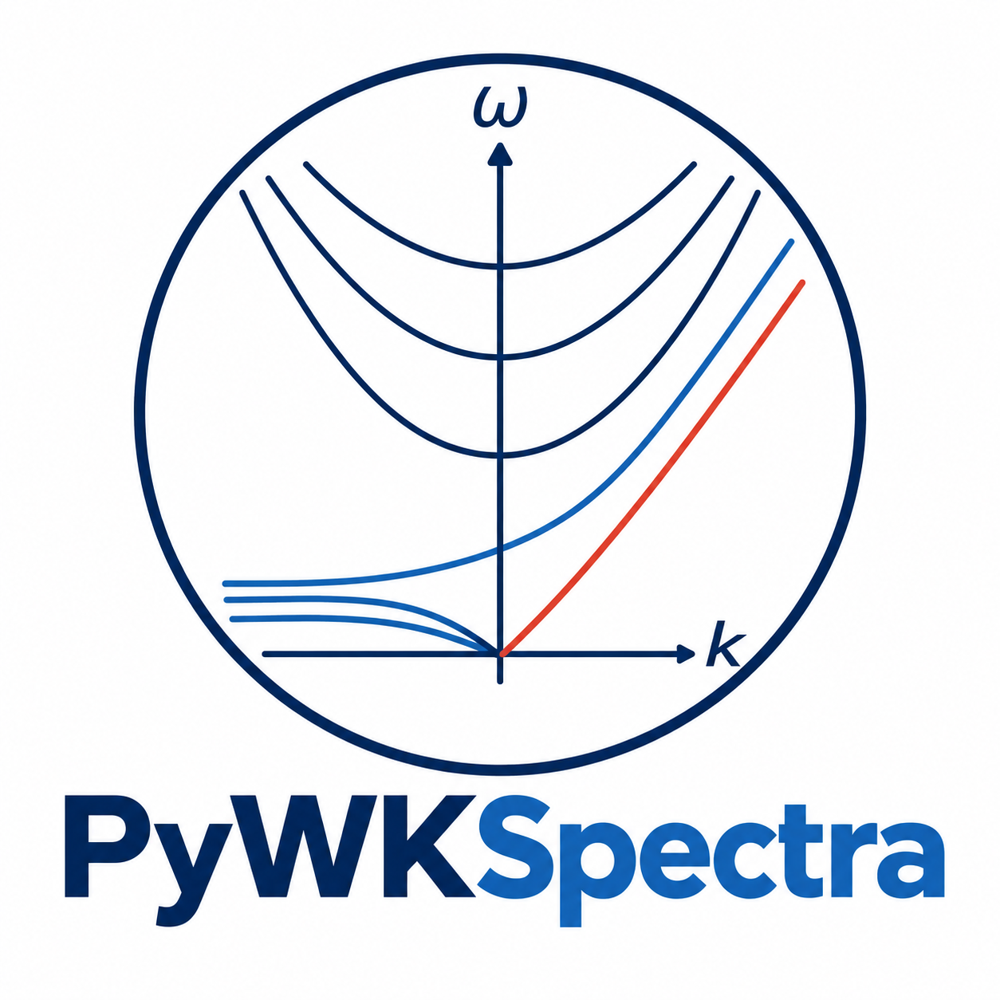

# PyWKSpectra

**Wheeler–Kiladis Space–Time Spectral Analysis in Python**

*A focused Python package for investigating tropical atmospheric variability through wavenumber–frequency spectra.*

> **Development status:** PyWKSpectra is under active development. The package is being redesigned and scientifically validated before its first public release. Its interface and features may change.

## About PyWKSpectra

**PyWKSpectra** is a Python package dedicated to calculating, analyzing, and visualizing **Wheeler–Kiladis space–time spectra**, widely used to investigate convectively coupled equatorial waves and other aspects of tropical atmospheric variability.

The goal is simple: **make Wheeler–Kiladis spectral analysis more reliable, transparent, modern, and easier to use**.

PyWKSpectra is not just a packaging update of an older implementation. It is an opportunity to revisit scientific choices, improve the computational workflow, and introduce carefully tested changes to how the analysis is performed.

The planned priorities are:

- Clear, reproducible computation of space–time spectra.
- Symmetric and antisymmetric spectral components.
- Background spectra and normalized spectral power.
- Equatorial-wave dispersion curves and publication-quality plots.
- More flexible inputs, transparent analysis options, and a convenient Python interface.
- Numerical validation, automated tests, and reproducible examples.

These are **development goals**, not a claim that every feature is already available.

## A little history (and a note on attribution)

This project began long before the name *PyWKSpectra* existed.

The original work was inspired by the **NCAR Command Language (NCL)** implementation of Wheeler–Kiladis spectral analysis, especially its [`wkSpaceTime` diagnostic](https://www.ncl.ucar.edu/Document/Functions/Diagnostics/wkSpaceTime.shtml). That implementation was an important reference for bringing the approach to Python.

I subsequently developed **[`wk_spectra`](https://github.com/mmaiergerber/wk_spectra)**, an earlier Python implementation of the method. Its original authorship and copyright records identify **Alejandro Jaramillo** as the original developer. I appreciate the interest and contributions that helped the software reach other researchers.

Over time, maintaining and extending the package without sustained support became difficult. Its development history also became less visible than I had hoped, sometimes leading to confusion about the original authorship. This is not meant as criticism of any individual; it is simply a reminder that **software provenance deserves the same care as data provenance**.

After all, Git can track every changed line of code, but citations still need a little help from humans.

**PyWKSpectra** is a new effort to improve the scientific implementation, modernize the software, simplify its use, and make the history, authorship, and citation instructions explicit. Previous contributions will be acknowledged appropriately.

## Scope

The initial public release will concentrate on **Wheeler–Kiladis spectra** and their scientific interpretation.

Specialized spectral filtering, inverse transforms, and wave-signal reconstruction are **outside the initial scope**. Those tools may be developed separately and are not promised as part of PyWKSpectra.

Better to have one well-tested spectral package than a collection of mysterious peaks and equally mysterious bugs.

## Installation and examples

Installation instructions, a minimal working example, and validated demonstration datasets will be provided when the package is ready for testing and distribution.

Until then, please treat the code as **work in progress**, rather than as a stable release.

## How to cite PyWKSpectra

**If PyWKSpectra contributes to your figures, analyses, or scientific results, please cite the software and its author.**

The foundational Wheeler and Kiladis (1999) article explains the scientific method; a software citation additionally recognizes the implementation, verification, documentation, and maintenance needed to make that method accessible.

A formal `CITATION.cff` file and a DOI for an archived software release will be provided before the first public release. Until then, please acknowledge the package as **PyWKSpectra — Alejandro Jaramillo Moreno** and link to its repository where appropriate.

*Spectral power may be symmetric or antisymmetric. Authorship should not be ambiguous.*

## Publications using PyWKSpectra

**Have you used PyWKSpectra in a paper, preprint, thesis, or report? Please send me the reference!**

I would be delighted to read your work and include it in a growing list of publications using the package. Seeing what researchers discover with the software is one of the most rewarding parts of sharing it.

*A publication list will be added once references are available.*

## The best way to say thanks

PyWKSpectra is being developed to support scientific research. If it saves you time or contributes to a result, there are three especially welcome ways to say thanks:

1. **Cite PyWKSpectra** in your publication.
2. **Share your article** so I can add it to the list of research using the package.
3. **Invite me to collaborate** when there is a meaningful scientific opportunity to work together.

Coffee certainly helps keep scientific code running, but **citations and collaborations are better long-term fuel**.

Constructive feedback, bug reports, and appropriately credited contributions are welcome too.

## Scientific reference

Wheeler, M., and G. N. Kiladis (1999): Convectively coupled equatorial waves: Analysis of clouds and temperature in the wavenumber–frequency domain. *Journal of the Atmospheric Sciences*, **56**, 374–399.

NCL reference: [`wkSpaceTime`](https://www.ncl.ucar.edu/Document/Functions/Diagnostics/wkSpaceTime.shtml).

## Author and maintainer

**Alejandro Jaramillo Moreno**  
Departamento de Cambio Climático  
Instituto de Ciencias de la Atmósfera y Cambio Climático (ICAyCC)  
Universidad Nacional Autónoma de México (UNAM)  
Mexico City, Mexico

**ORCID:** [0000-0002-4175-7726](https://orcid.org/0000-0002-4175-7726)  
**Email:** [ajaramillo@atmosfera.unam.mx](mailto:ajaramillo@atmosfera.unam.mx)

## License and acknowledgments

A distribution license will be selected before the first public release. Until that is done, **no general permission to redistribute or reuse new PyWKSpectra code is granted by this README**. Existing code reused from earlier projects remains subject to its original license terms and attribution requirements.

PyWKSpectra acknowledges the pioneering work of **Wheeler and Kiladis (1999)**, the **NCL** implementation that inspired the original Python work, and the contributions of researchers and users over the years.

---

*May your spectral peaks be physically meaningful, your tests pass, and your citations point to the right author.*
